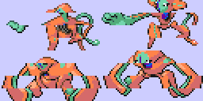
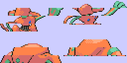
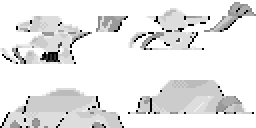
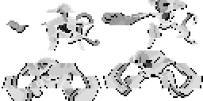
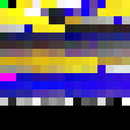
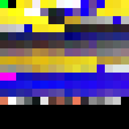
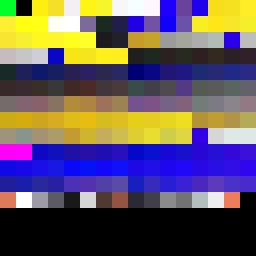

# LeafGreen public graphics

This page is generated from the repository's verified `graphics/` tree. Japanese and Korean assets are listed before English and other official languages.

## Header

| Preview | File | Language | Size | SHA-256 |
| --- | --- | --- | --- | --- |
|  | [`graphics/header/nintendo-logo-jp.png`](graphics/header/nintendo-logo-jp.png) | Japanese | 416x64 | `f07daf6e489d64b7...` |

## Pokemon

| Preview | File | Language | Size | SHA-256 |
| --- | --- | --- | --- | --- |
|  | [`graphics/pokemon/deoxys-defense-back-jp.png`](graphics/pokemon/deoxys-defense-back-jp.png) | Japanese | 256x128 | `2e50a8e721440394...` |
|  | [`graphics/pokemon/deoxys-defense-front-jp.png`](graphics/pokemon/deoxys-defense-front-jp.png) | Japanese | 256x128 | `13f0f7434eab509a...` |
|  | [`graphics/pokemon/deoxys-defense-back-en.png`](graphics/pokemon/deoxys-defense-back-en.png) | English | 256x128 | `2e50a8e721440394...` |
|  | [`graphics/pokemon/deoxys-defense-front-en.png`](graphics/pokemon/deoxys-defense-front-en.png) | English | 256x128 | `13f0f7434eab509a...` |
|  | [`graphics/pokemon/deoxys-defense-back-de.png`](graphics/pokemon/deoxys-defense-back-de.png) | German | 256x128 | `2e50a8e721440394...` |
|  | [`graphics/pokemon/deoxys-defense-front-de.png`](graphics/pokemon/deoxys-defense-front-de.png) | German | 256x128 | `13f0f7434eab509a...` |
|  | [`graphics/pokemon/deoxys-defense-back-fr.png`](graphics/pokemon/deoxys-defense-back-fr.png) | French | 256x128 | `2e50a8e721440394...` |
|  | [`graphics/pokemon/deoxys-defense-front-fr.png`](graphics/pokemon/deoxys-defense-front-fr.png) | French | 256x128 | `13f0f7434eab509a...` |
|  | [`graphics/pokemon/deoxys-defense-back-it.png`](graphics/pokemon/deoxys-defense-back-it.png) | Italian | 256x128 | `2e50a8e721440394...` |
|  | [`graphics/pokemon/deoxys-defense-front-it.png`](graphics/pokemon/deoxys-defense-front-it.png) | Italian | 256x128 | `13f0f7434eab509a...` |
|  | [`graphics/pokemon/deoxys-defense-back-es.png`](graphics/pokemon/deoxys-defense-back-es.png) | Spanish | 256x128 | `2e50a8e721440394...` |
|  | [`graphics/pokemon/deoxys-defense-front-es.png`](graphics/pokemon/deoxys-defense-front-es.png) | Spanish | 256x128 | `13f0f7434eab509a...` |
|  | [`graphics/pokemon/deoxys-normal-de-swatch.png`](graphics/pokemon/deoxys-normal-de-swatch.png) | Unspecified | 256x16 | `eb02b518552821e7...` |
|  | [`graphics/pokemon/deoxys-normal-en-swatch.png`](graphics/pokemon/deoxys-normal-en-swatch.png) | Unspecified | 256x16 | `eb02b518552821e7...` |
|  | [`graphics/pokemon/deoxys-normal-es-swatch.png`](graphics/pokemon/deoxys-normal-es-swatch.png) | Unspecified | 256x16 | `eb02b518552821e7...` |
|  | [`graphics/pokemon/deoxys-normal-fr-swatch.png`](graphics/pokemon/deoxys-normal-fr-swatch.png) | Unspecified | 256x16 | `eb02b518552821e7...` |
|  | [`graphics/pokemon/deoxys-normal-it-swatch.png`](graphics/pokemon/deoxys-normal-it-swatch.png) | Unspecified | 256x16 | `eb02b518552821e7...` |
|  | [`graphics/pokemon/deoxys-normal-jp-swatch.png`](graphics/pokemon/deoxys-normal-jp-swatch.png) | Unspecified | 256x16 | `eb02b518552821e7...` |

| Palette | Language | Colors | SHA-256 |
| --- | --- | --- | --- |
| [`graphics/pokemon/deoxys-normal-jp.pal`](graphics/pokemon/deoxys-normal-jp.pal) | Japanese | 16 | `479c76fdaf9a0ca4...` |
| [`graphics/pokemon/deoxys-normal-en.pal`](graphics/pokemon/deoxys-normal-en.pal) | English | 16 | `479c76fdaf9a0ca4...` |
| [`graphics/pokemon/deoxys-normal-de.pal`](graphics/pokemon/deoxys-normal-de.pal) | German | 16 | `479c76fdaf9a0ca4...` |
| [`graphics/pokemon/deoxys-normal-fr.pal`](graphics/pokemon/deoxys-normal-fr.pal) | French | 16 | `479c76fdaf9a0ca4...` |
| [`graphics/pokemon/deoxys-normal-it.pal`](graphics/pokemon/deoxys-normal-it.pal) | Italian | 16 | `479c76fdaf9a0ca4...` |
| [`graphics/pokemon/deoxys-normal-es.pal`](graphics/pokemon/deoxys-normal-es.pal) | Spanish | 16 | `479c76fdaf9a0ca4...` |

## Title

| Preview | File | Language | Size | SHA-256 |
| --- | --- | --- | --- | --- |
|  | [`graphics/title/game-title-logo-en.png`](graphics/title/game-title-logo-en.png) | English | 256x64 | `e9786659360e9ff0...` |
|  | [`graphics/title/game-title-logo-de.png`](graphics/title/game-title-logo-de.png) | German | 256x64 | `0e944d0071f3840a...` |
|  | [`graphics/title/game-title-logo-fr.png`](graphics/title/game-title-logo-fr.png) | French | 256x64 | `e60f20957a998266...` |
|  | [`graphics/title/game-title-logo-it.png`](graphics/title/game-title-logo-it.png) | Italian | 256x64 | `410a01b4f5a3d789...` |
|  | [`graphics/title/game-title-logo-es.png`](graphics/title/game-title-logo-es.png) | Spanish | 256x64 | `d1303d05f0637513...` |
|  | [`graphics/title/de-version-sprite-sheet-0.png`](graphics/title/de-version-sprite-sheet-0.png) | Unspecified | 256x128 | `81aa5016125f9862...` |
|  | [`graphics/title/de-version-sprite-sheet-1.png`](graphics/title/de-version-sprite-sheet-1.png) | Unspecified | 256x128 | `83f8a6d0907cd014...` |
|  | [`graphics/title/en-version-sprite-sheet-0.png`](graphics/title/en-version-sprite-sheet-0.png) | Unspecified | 256x128 | `81aa5016125f9862...` |
|  | [`graphics/title/en-version-sprite-sheet-1.png`](graphics/title/en-version-sprite-sheet-1.png) | Unspecified | 256x128 | `83f8a6d0907cd014...` |
|  | [`graphics/title/es-version-sprite-sheet-0.png`](graphics/title/es-version-sprite-sheet-0.png) | Unspecified | 256x128 | `81aa5016125f9862...` |
|  | [`graphics/title/es-version-sprite-sheet-1.png`](graphics/title/es-version-sprite-sheet-1.png) | Unspecified | 256x128 | `83f8a6d0907cd014...` |
|  | [`graphics/title/fr-version-sprite-sheet-0.png`](graphics/title/fr-version-sprite-sheet-0.png) | Unspecified | 256x128 | `81aa5016125f9862...` |
|  | [`graphics/title/fr-version-sprite-sheet-1.png`](graphics/title/fr-version-sprite-sheet-1.png) | Unspecified | 256x128 | `83f8a6d0907cd014...` |
|  | [`graphics/title/game-title-logo-de-swatch.png`](graphics/title/game-title-logo-de-swatch.png) | Unspecified | 256x256 | `373cf24892f75a39...` |
|  | [`graphics/title/game-title-logo-en-swatch.png`](graphics/title/game-title-logo-en-swatch.png) | Unspecified | 256x256 | `7f079bcbcf71ed4e...` |
|  | [`graphics/title/game-title-logo-es-swatch.png`](graphics/title/game-title-logo-es-swatch.png) | Unspecified | 256x256 | `4c85a7b7e12f3695...` |
|  | [`graphics/title/game-title-logo-fr-swatch.png`](graphics/title/game-title-logo-fr-swatch.png) | Unspecified | 256x256 | `8890743d381019e6...` |
|  | [`graphics/title/game-title-logo-it-swatch.png`](graphics/title/game-title-logo-it-swatch.png) | Unspecified | 256x256 | `084c81f4e94d8a85...` |
|  | [`graphics/title/it-version-sprite-sheet-0.png`](graphics/title/it-version-sprite-sheet-0.png) | Unspecified | 256x128 | `81aa5016125f9862...` |
|  | [`graphics/title/it-version-sprite-sheet-1.png`](graphics/title/it-version-sprite-sheet-1.png) | Unspecified | 256x128 | `83f8a6d0907cd014...` |
|  | [`graphics/title/jp-version-sprite-sheet-0.png`](graphics/title/jp-version-sprite-sheet-0.png) | Unspecified | 256x128 | `81aa5016125f9862...` |
|  | [`graphics/title/jp-version-sprite-sheet-1.png`](graphics/title/jp-version-sprite-sheet-1.png) | Unspecified | 256x128 | `83f8a6d0907cd014...` |

| Palette | Language | Colors | SHA-256 |
| --- | --- | --- | --- |
| [`graphics/title/game-title-logo-en.pal`](graphics/title/game-title-logo-en.pal) | English | 256 | `8ddd05bd07606414...` |
| [`graphics/title/game-title-logo-de.pal`](graphics/title/game-title-logo-de.pal) | German | 256 | `4ce41ef11072152f...` |
| [`graphics/title/game-title-logo-fr.pal`](graphics/title/game-title-logo-fr.pal) | French | 256 | `ac18daafc02a72e1...` |
| [`graphics/title/game-title-logo-it.pal`](graphics/title/game-title-logo-it.pal) | Italian | 256 | `f77ef2e787ec8761...` |
| [`graphics/title/game-title-logo-es.pal`](graphics/title/game-title-logo-es.pal) | Spanish | 256 | `91dae9191d32b7b1...` |

Every entry is tied to at least one existing analysis or manifest record. Full hashes and provenance links are in `analysis/public-graphics-catalog.json`.
